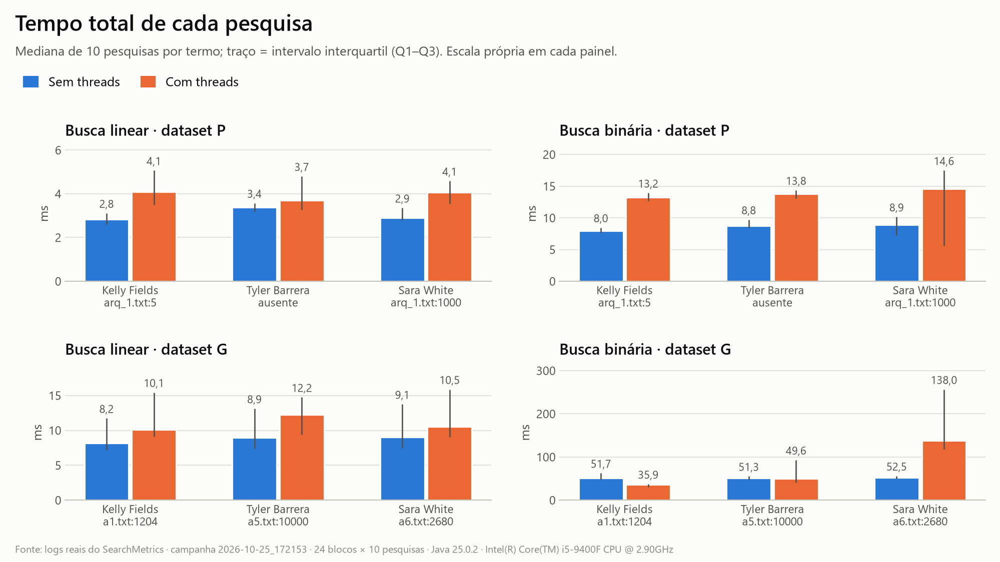
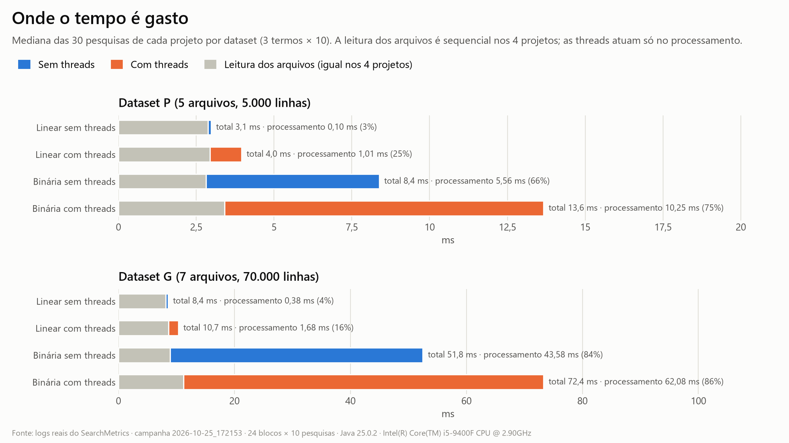
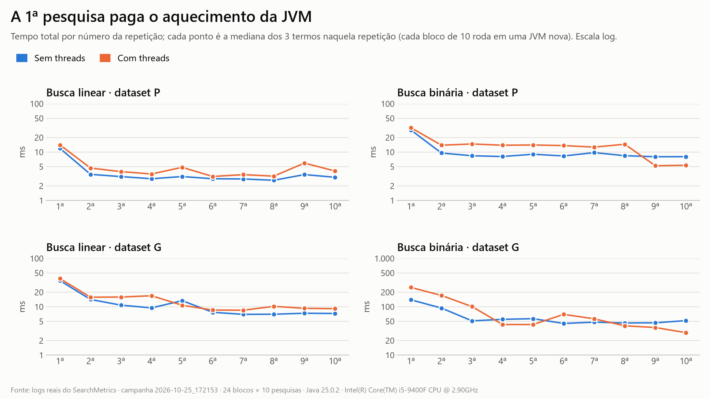
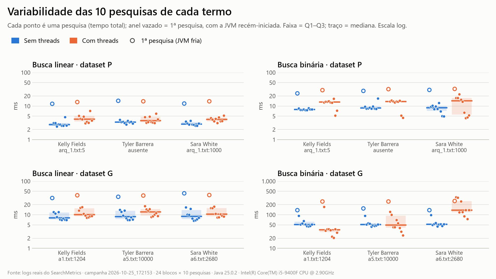
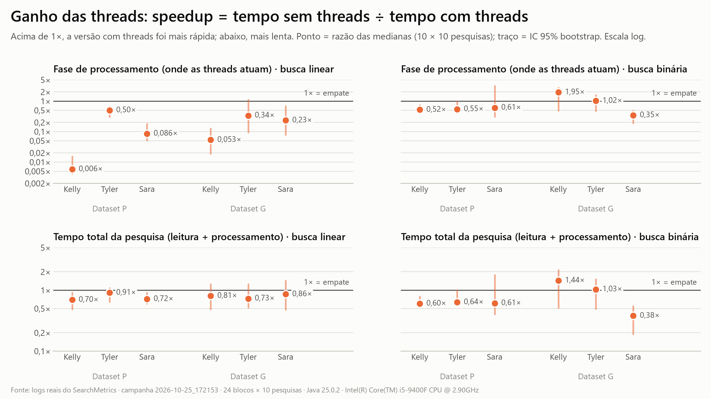
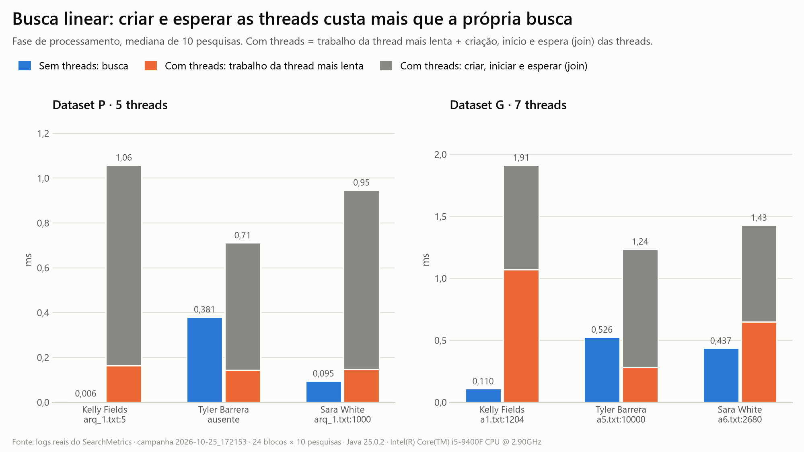
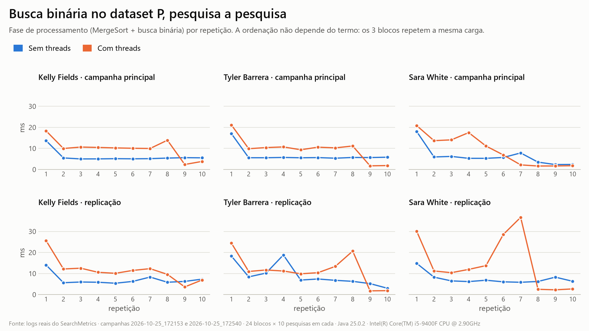
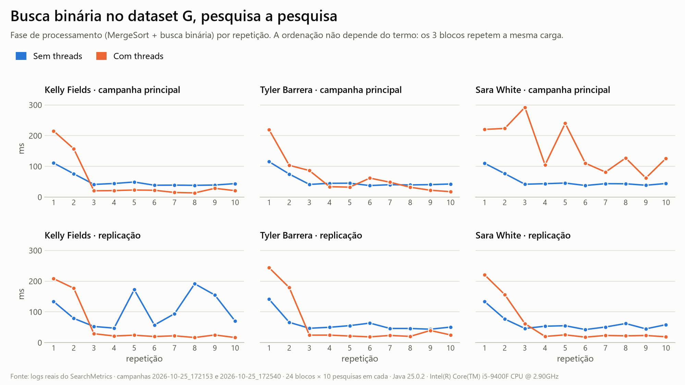
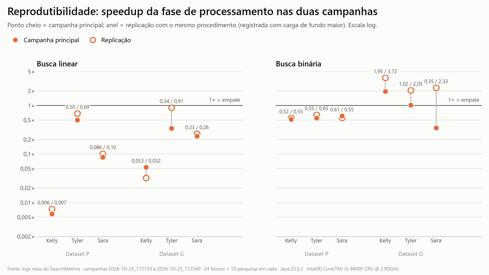

# Análise de resultados: busca em arquivos com e sem threads

| | |
| --- | --- |
| **Data da medição** | 25/10/2026 |
| **Código analisado** | commit `57d7af9` (nenhum arquivo dos quatro projetos foi alterado) |
| **Campanha principal** | `analise/campanhas/2026-10-25_172153` — 240 pesquisas |
| **Replicação** | `analise/campanhas/2026-10-25_172540` — mais 240 pesquisas, mesmo procedimento |
| **Fonte dos números** | logs `logs/*.properties` gravados pelo `SearchMetrics` de cada projeto, processados por `analise/processar_logs.py` |
| **Máquina** | Intel Core i5-9400F (6 núcleos, 6 threads), 16 GB, Windows 11 Pro, Java 25.0.2 (HotSpot) |

Todos os valores deste relatório vêm dos logs reais. As tabelas foram geradas pelo script (cópia integral em `analise/resultados/tabelas.md`) e os gráficos estão em `analise/graficos/`. Tempos em milissegundos (ms); "speedup" = mediana sem threads ÷ mediana com threads (acima de 1 = as threads ajudaram).

---

## Sumário executivo

- **Foram executadas as 240 pesquisas pedidas** (4 projetos × datasets P e G × 3 termos × 10 repetições) e mais 240 em uma replicação. Os 480 logs passaram nas 26 verificações automáticas, incluindo a conferência de cada resultado com uma busca refeita diretamente nos arquivos.
- **Busca linear: as threads não compensaram.** Na fase em que atuam, a versão com threads foi mais lenta nas 12 condições das duas campanhas — na principal, de 2× a cerca de 170× mais lenta (speedup de 0,006× a 0,50×). Só criar, iniciar e esperar as 5–7 threads custa de 0,57 a 0,96 ms por pesquisa (mediana), mais do que a busca sequencial inteira (0,006 a 0,53 ms). Comparando repetição a repetição, a versão com threads perdeu em 53 de 54 pares na campanha principal e em 51 de 54 na replicação.
- **A leitura dos arquivos domina o tempo total e é sequencial nos quatro projetos.** Na busca linear sem threads, o processamento é só 3,2% (P) e 4,4% (G) do total; pela Lei de Amdahl, paralelizar apenas essa fase daria no máximo 1,03× a 1,05×, mesmo com infinitos núcleos.
- **Busca binária no dataset P: threads mais lentas** — speedup de 0,52× a 0,61× no processamento e de 0,60× a 0,64× no tempo total.
- **Busca binária no dataset G: ganho real, mas instável.** Depois que a JVM aquece, a versão com threads ordena e busca em cerca de 15–30 ms, contra 40–60 ms da sequencial, em 4 dos 6 blocos das duas campanhas. Na replicação, o speedup agregado foi 2,36× (IC 95% 2,07–2,96; p < 0,001). Na campanha principal, porém, um bloco inteiro ficou 0,35× e o agregado foi 0,70× (IC 0,39–1,46; não significativo). A eficiência ficou entre 0,33 e 0,39 (o ideal seria 1).
- **O algoritmo pesou mais do que as threads.** A busca binária refaz o MergeSort em toda pesquisa e foi 2,8× (P) e 6,1× (G) mais lenta que a linear sem threads; mesmo o melhor resultado da binária com threads ficou entre 2,8× e 4,4× mais lento que a linear sem threads.
- **Veredito:** com estes dados e este desenho (uma thread nova por arquivo em cada pesquisa), as threads **não são viáveis** na busca linear e trazem **ganho apenas condicional** na busca binária do dataset G — que, ainda assim, perde para a busca linear sequencial. Na campanha principal, o projeto mais rápido nas 6 condições foi `sem_paralelismo`.

---

## 1. Objetivo e escopo

Medir, com logs reais, o desempenho dos quatro projetos do repositório ao pesquisar **Kelly Fields**, **Tyler Barrera** e **Sara White**, 10 vezes cada, nos datasets **P** e **G** (60 pesquisas por projeto, 240 no total), e responder com evidências:

1. Qual projeto/algoritmo é mais rápido em cada situação?
2. Como o desempenho varia entre datasets, termos e repetições?
3. As threads trouxeram ganho real, ou o custo de criá-las e coordená-las anulou o benefício?

---

## 2. Os quatro projetos

### 2.1 Fluxo comum

Nos quatro projetos, o botão PESQUISAR da `MainWindow` (Swing) chama `SearchUtils.Search(caminho, termo)`, que:

1. lista os arquivos do dataset com `FileUtils.listFiles` (arquivos com "." no nome, na ordem do sistema de arquivos — alfabética no NTFS);
2. lê cada arquivo com `FileUtils.readAllLines` (`BufferedReader`), criando um objeto `Line(arquivo, número, texto)` por linha — **sempre na própria thread que chamou a busca, um arquivo depois do outro**;
3. processa as linhas (é aqui que os projetos diferem);
4. registra as métricas da pesquisa com `SearchMetrics` (classe idêntica nos quatro projetos, conferida com `diff`).

A comparação é exata: `linha.trim().equals(termo)`, diferenciando maiúsculas e minúsculas.

### 2.2 O que muda entre eles

| Projeto | Processamento | Threads | Ordenação | Resultado devolvido | Custo por pesquisa |
| --- | --- | --- | --- | --- | --- |
| `sem_paralelismo` | busca linear em uma lista única com todas as linhas; para no 1º acerto | nenhuma | não | 1ª ocorrência global | proporcional à posição do acerto (todas as linhas se o termo não existe) |
| `com_paralelismo` | uma `SearchThread` (`extends Thread`) por arquivo; cada uma percorre seu arquivo até o 1º acerto; depois `join` e concatenação | 5 (P) ou 7 (G), criadas a cada pesquisa | não | 1ª ocorrência por arquivo | todas as linhas dos arquivos sem acerto, divididas entre as threads, + criação das threads |
| `sem_paralelismo_binary_search` | para cada arquivo: `MergeSort` recursivo + busca binária (limite inferior) | nenhuma | sim, em toda pesquisa | 1ª ocorrência por arquivo | O(n log n) por pesquisa |
| `com_paralelismo_binary_search` | uma `Thread` (lambda) por arquivo, fazendo MergeSort + busca binária; depois `join` | 5 (P) ou 7 (G), criadas a cada pesquisa | sim, em toda pesquisa | 1ª ocorrência por arquivo | O(n log n) dividido entre as threads + criação das threads |

### 2.3 Pontos do código que explicam os resultados

1. **A leitura nunca é paralela.** Em todos os projetos, as threads atuam só na fase de processamento; a leitura, que é a maior parte do tempo na busca linear, continua sequencial.
2. **A ordenação é refeita em toda pesquisa.** Os projetos binários não guardam a lista ordenada entre consultas; cada pesquisa paga o MergeSort completo (que cria uma `ArrayList` nova a cada intercalação e chama `trim()` em cada comparação).
3. **Políticas de resultado diferentes.** A linear sem threads para no primeiro acerto do dataset inteiro; as outras examinam todos os arquivos. Como cada termo aparece **no máximo uma vez** em cada dataset, os quatro projetos devolvem exatamente o mesmo resultado (verificado em todas as pesquisas), mas o **trabalho** é diferente (seção 9.1).
4. **Threads novas a cada pesquisa**, sem pool: o custo de criar, iniciar e esperar as threads é pago em todas as consultas.
5. **No dataset G há 7 threads para 6 núcleos.**
6. **Corretude:** o MergeSort é estável e a busca binária procura o limite inferior, então ela devolve a primeira ocorrência do arquivo, coerente com a busca linear. Cada thread grava só na própria lista, lida pela thread principal depois do `join` (que garante a visibilidade); as métricas usam `LongAdder` e `Properties`, que são seguros para várias threads. Não foram encontradas condições de corrida.
7. `com_paralelismo_binary_search` contém `SearchThread` e `LinearSearch` sem uso (código morto, sem efeito nas medições).
8. O relatório em PDF já existente (`relatorio-analise-resultados.pdf`) mediu uma **versão anterior** do código (busca por prefixo com `split(" ")` e ordenação de todas as linhas na versão sequencial). Os números dele não são comparáveis com os deste relatório.

### 2.4 O que cada métrica do log mede

| Campo | Significado |
| --- | --- |
| `total_ns` | do fim da criação do `SearchMetrics` até o início do `finish()`: listagem, leitura, processamento e anotações de métricas. Exclui a gravação do log e a interface. |
| `read_wall_ns` | listagem + leitura de todos os arquivos (sequencial nos 4 projetos) |
| `processing_wall_ns` | busca (linear) ou MergeSort + busca (binária), incluindo criação, início e `join` das threads |
| `file.N.search_ns`, `file.N.sort_ns` | tempo medido **dentro** de cada thread (ou de cada arquivo, no binário sequencial) |
| `process_cpu_ns`, `gc_*`, `heap_*` | CPU, coletas de lixo e heap de **toda a JVM** durante a pesquisa |

---

## 3. Ambiente de execução

| Item | Valor |
| --- | --- |
| Processador | Intel Core i5-9400F @ 2,90 GHz — 6 núcleos físicos, 6 processadores lógicos (`available_processors = 6`) |
| Memória | 16 GB (17.139.990.528 bytes) |
| Sistema | Windows 11 Pro 10.0.26200, plano de energia "Equilibrado" |
| Java | 25.0.2 LTS, Java HotSpot 64-Bit Server VM, flags padrão: G1, heap inicial de 255 MiB e máximo de 4 GiB |
| Datasets | idênticos nos quatro projetos (SHA-256 conferido antes de cada campanha). P: 5 arquivos × 1.000 linhas (76.436 bytes). G: 7 arquivos × 10.000 linhas (1.070.014 bytes). Quebras de linha CRLF. |
| Carga de fundo — principal | média de 35,8% de CPU antes (amostras 34, 47, 24, 41, 33%) e 28,4% depois; maiores consumidores: iCUE (≈1 núcleo), Discord, IntelliJ, QmlRenderer |
| Carga de fundo — replicação | média de 60,8% antes (amostras 23, 24, 63, 100, 94%) e 53,4% depois; mesmos processos, com picos |

A carga de fundo foi registrada automaticamente em `analise/campanhas/<id>/ambiente.txt`, junto com o commit, as flags da JVM e os hashes dos datasets. Antes da campanha principal, foram fechados os aplicativos possíveis; segundo a medição, o Discord e processos de segundo plano (iCUE, IntelliJ, QmlRenderer) continuaram ativos.

---

## 4. Metodologia

### 4.1 Desenho

- **4 projetos × 2 datasets × 3 termos × 10 repetições = 240 pesquisas** na campanha principal.
- Cada **bloco** (projeto, dataset, termo) roda em **uma JVM nova**, com as 10 repetições em sequência. Assim, todas as condições partem do mesmo estado: a 1ª pesquisa de cada bloco é sempre "fria" (JVM recém-iniciada, código ainda interpretado), como o primeiro clique em PESQUISAR.
- **Ordem rotacionada:** em cada condição (dataset, termo), os quatro projetos rodam um após o outro, e a ordem gira uma posição a cada condição. Isso espalha efeitos de horário e de carga entre os projetos.
- Antes de começar, todos os datasets são lidos uma vez (sem gerar logs), para que o cache de arquivos do sistema operacional esteja igual para todos.

Os termos ocupam posições diferentes nos arquivos, o que permite observar o efeito da posição:

| Dataset | Termo | Ocorrência (arquivo:linha) |
| --- | --- | --- |
| P | Kelly Fields | arq_1.txt:5 |
| P | Tyler Barrera | ausente |
| P | Sara White | arq_1.txt:1000 |
| G | Kelly Fields | a1.txt:1204 |
| G | Tyler Barrera | a5.txt:10000 |
| G | Sara White | a6.txt:2680 |

### 4.2 Execução

- `analise/ExecutorPesquisas.java` chama `SearchUtils.Search` **com o mesmo caminho relativo usado pela `MainWindow`** (`./<projeto>/datasets/<p|g>`), a partir da raiz do repositório, sem abrir a interface. Ele é compilado junto com o código de cada projeto, em uma pasta temporária própria (as classes dos projetos têm os mesmos nomes).
- Os logs são gravados pelo próprio `SearchMetrics` de cada projeto, em `logs/`. O executor só identifica qual log cada pesquisa gerou e anota isso no manifesto `analise/campanhas/<id>/manifesto.csv`, junto com o resultado devolvido e o tempo medido por fora (que inclui a gravação do log).
- `analise/executar_pesquisas.sh` faz tudo: confere os hashes dos datasets, registra o ambiente e a carga de fundo, compila, aquece o cache e executa os 24 blocos. Cada campanha levou cerca de 45 s.
- **Replicação:** logo depois da campanha principal, o mesmo script foi executado de novo, gerando outras 240 pesquisas. Ela serve só para verificar se as conclusões se repetem; **todas as tabelas e gráficos principais usam a campanha principal**.

### 4.3 Estatística

- **Medida central principal: mediana** das 10 pesquisas de cada condição (robusta à 1ª pesquisa, que é muito mais lenta). Também são apresentados média, desvio-padrão (DP), coeficiente de variação (CV = DP ÷ média), quartis (Q1–Q3), mínimo, máximo, a 1ª pesquisa isolada e a mediana da 2ª à 10ª.
- **Speedup** = mediana sem threads ÷ mediana com threads, por condição. **Eficiência** = speedup ÷ núcleos usáveis (5 no P; 6 no G, já que são 7 threads para 6 núcleos).
- **Intervalo de confiança de 95%** do speedup por bootstrap (10.000 reamostragens independentes de cada grupo, semente fixa 20261025).
- **Teste de Mann-Whitney** (bilateral, 10 × 10) para cada uma das 12 comparações por métrica, com **correção de Holm** para comparações múltiplas; **δ de Cliff** como tamanho de efeito (positivo = versão com threads mais lenta).
- **Pareamento por repetição:** como cada bloco segue a mesma sequência de aquecimento, a repetição *k* sem threads é comparada com a repetição *k* com threads (2ª à 10ª, 3 termos = 27 pares), com **teste de sinais** (binomial).
- **Lei de Amdahl:** teto teórico do speedup do tempo total, considerando que só a fase de processamento é paralelizável.
- **Controle:** a fase de leitura usa o mesmo código nos quatro projetos; diferenças nela indicam ruído do ambiente ou efeitos residuais dentro da JVM (teste de Kruskal-Wallis entre projetos e correlação de Spearman com a ordem de execução).
- Critérios definidos antes das medições: mediana como medida principal, "repetições quentes" = 2ª à 10ª, nível de 5%. **Decididos depois da primeira inspeção dos dados:** a campanha de replicação (motivada pela instabilidade da binária com threads no G) e o pareamento por repetição, que usa a mesma definição prévia de repetições quentes.

---

## 5. Validação dos logs

`processar_logs.py` só gera estatísticas e gráficos se todas as verificações passarem (senão termina com código 1). Resultado para os 480 logs (`analise/resultados/validacao.txt`):

| Verificação | Resultado |
| --- | --- |
| Manifesto com 240 pesquisas por campanha | 2/2 |
| Cada log existe, é usado por uma única pesquisa e tem `status=success` | 480/480 |
| `module`, `query`, `algorithm`, `result_policy` e caminho do dataset conferem com o projeto e o termo | 480/480 |
| Arquivos lidos = arquivos do dataset; linhas e bytes de cada arquivo conferem com o disco | 2.880/2.880 arquivos |
| `loaded_lines` e `dataset_bytes` conferem com o disco | 480/480 |
| **Resultado do log = resultado recalculado** lendo os arquivos e aplicando a política do projeto | 480/480 |
| Resultado devolvido ao executor = resultado gravado no log | 480/480 |
| Tempos positivos, leitura + processamento ≤ total, tempo externo ≥ `total_ns` | 480/480 |
| `worker_threads`, `sorting_enabled` e tempos por arquivo/thread coerentes com os totais | 480/480 |
| Repetições 1 a 10 em cada bloco, uma JVM por bloco, JVMs diferentes entre blocos | 48/48 blocos |
| Mesmo Java e mesmo número de processadores em todos os logs | 2/2 |

**Teste negativo:** em uma cópia dos logs fora do repositório, a linha de um resultado foi alterada (2680 → 2681). O script apontou a pesquisa exata em duas verificações e terminou com código 1, sem gerar saídas. Os testes já existentes do projeto (`tests/run_metrics_tests.sh`) também passaram nos quatro módulos antes das campanhas.

Os logs originais não foram modificados; o script apenas os lê.

---

## 6. Resultados individuais por projeto (campanha principal)

"1ª (fria)" é a primeira pesquisa do bloco, com a JVM recém-iniciada. "CV % 2ª–10ª" mede a variação sem ela.

### 6.1 Linear sem threads (`sem_paralelismo`)

| Dataset | Termo | Resultado | Mediana total | Q1 – Q3 | Média ± DP | CV % | CV % 2ª–10ª | Mín. – Máx. | 1ª (fria) | Mediana 2ª–10ª | Mediana leitura | Mediana processamento |
| --- | --- | --- | ---: | ---: | ---: | ---: | ---: | ---: | ---: | ---: | ---: | ---: |
| P | Kelly Fields | arq_1.txt:5 | 2,84 | 2,61 – 3,11 | 3,87 ± 2,86 | 73,9 | 22,5 | 2,49 – 11,79 | 11,79 | 2,82 | 2,83 | 0,006 |
| P | Tyler Barrera | ausente | 3,37 | 3,17 – 3,57 | 4,43 ± 3,51 | 79,1 | 9,8 | 2,80 – 14,37 | 14,37 | 3,35 | 2,98 | 0,381 |
| P | Sara White | arq_1.txt:1000 | 2,91 | 2,79 – 3,35 | 3,87 ± 2,87 | 74,1 | 12,3 | 2,59 – 11,97 | 11,97 | 2,81 | 2,81 | 0,095 |
| G | Kelly Fields | a1.txt:1204 | 8,16 | 7,18 – 11,72 | 11,14 ± 7,56 | 67,9 | 24,8 | 6,97 – 31,85 | 31,85 | 7,80 | 8,02 | 0,110 |
| G | Tyler Barrera | a5.txt:10000 | 8,93 | 7,42 – 13,11 | 12,17 ± 8,39 | 68,9 | 29,6 | 7,02 – 34,77 | 34,77 | 8,38 | 8,43 | 0,526 |
| G | Sara White | a6.txt:2680 | 9,06 | 7,43 – 13,75 | 13,21 ± 11,24 | 85,1 | 36,9 | 6,63 – 43,68 | 43,68 | 8,16 | 8,56 | 0,437 |

- **Foi o projeto mais rápido nas 6 condições.**
- A busca em si é quase gratuita: de 0,006 ms (Kelly no P, achado na 5ª linha) a 0,53 ms (Tyler no G, 50.000 linhas examinadas). O resto do tempo é leitura.
- A posição do termo importa: no P, Tyler (ausente, 5.000 linhas examinadas) levou 0,381 ms de processamento; Kelly, 0,006 ms.

### 6.2 Linear com threads (`com_paralelismo`)

| Dataset | Termo | Resultado | Mediana total | Q1 – Q3 | Média ± DP | CV % | CV % 2ª–10ª | Mín. – Máx. | 1ª (fria) | Mediana 2ª–10ª | Mediana leitura | Mediana processamento |
| --- | --- | --- | ---: | ---: | ---: | ---: | ---: | ---: | ---: | ---: | ---: | ---: |
| P | Kelly Fields | arq_1.txt:5 | 4,09 | 3,49 – 5,07 | 5,20 ± 3,09 | 59,3 | 29,7 | 3,08 – 13,29 | 13,29 | 4,03 | 3,09 | 1,030 |
| P | Tyler Barrera | ausente | 3,71 | 3,27 – 4,80 | 4,98 ± 3,33 | 66,8 | 24,7 | 3,14 – 14,09 | 14,09 | 3,36 | 3,12 | 0,761 |
| P | Sara White | arq_1.txt:1000 | 4,06 | 3,54 – 4,59 | 5,03 ± 3,25 | 64,6 | 16,7 | 3,13 – 14,10 | 14,10 | 3,94 | 2,85 | 1,112 |
| G | Kelly Fields | a1.txt:1204 | 10,11 | 9,09 – 15,44 | 13,98 ± 9,12 | 65,3 | 29,8 | 8,11 – 38,33 | 38,33 | 9,57 | 8,20 | 2,053 |
| G | Tyler Barrera | a5.txt:10000 | 12,23 | 9,43 – 14,74 | 14,70 ± 8,77 | 59,7 | 27,3 | 8,56 – 38,04 | 38,04 | 11,22 | 9,36 | 1,561 |
| G | Sara White | a6.txt:2680 | 10,54 | 9,03 – 15,87 | 14,41 ± 9,27 | 64,4 | 31,0 | 8,28 – 38,95 | 38,95 | 10,34 | 8,87 | 1,877 |

- O tempo total ficou acima da versão sem threads em todas as condições.
- O processamento (0,76 a 2,05 ms) é dominado pela gestão das threads, não pela busca (seção 9.1).

### 6.3 Binária sem threads (`sem_paralelismo_binary_search`)

| Dataset | Termo | Resultado | Mediana total | Q1 – Q3 | Média ± DP | CV % | CV % 2ª–10ª | Mín. – Máx. | 1ª (fria) | Mediana 2ª–10ª | Mediana leitura | Mediana processamento |
| --- | --- | --- | ---: | ---: | ---: | ---: | ---: | ---: | ---: | ---: | ---: | ---: |
| P | Kelly Fields | arq_1.txt:5 | 7,98 | 7,66 – 8,46 | 9,59 ± 5,09 | 53,1 | 5,3 | 7,59 – 24,03 | 24,03 | 7,96 | 2,63 | 5,279 |
| P | Tyler Barrera | ausente | 8,78 | 8,43 – 9,71 | 11,61 ± 6,52 | 56,2 | 28,5 | 8,32 – 28,61 | 28,61 | 8,53 | 3,15 | 5,650 |
| P | Sara White | arq_1.txt:1000 | 8,94 | 7,27 – 10,16 | 10,62 ± 7,40 | 69,7 | 29,4 | 4,99 – 30,61 | 30,61 | 8,31 | 3,56 | 5,497 |
| G | Kelly Fields | a1.txt:1204 | 51,65 | 47,74 – 62,44 | 64,35 ± 29,70 | 46,2 | 26,8 | 45,15 – 138,62 | 138,62 | 51,56 | 10,35 | 42,673 |
| G | Tyler Barrera | a5.txt:10000 | 51,30 | 48,10 – 55,29 | 64,97 ± 35,19 | 54,2 | 27,6 | 44,44 – 156,51 | 156,51 | 51,14 | 8,55 | 42,049 |
| G | Sara White | a6.txt:2680 | 52,51 | 50,50 – 55,91 | 64,51 ± 30,25 | 46,9 | 28,3 | 45,16 – 139,32 | 139,32 | 52,38 | 8,59 | 43,774 |

- O MergeSort domina: 5,3 a 5,7 ms no P e 42,0 a 43,8 ms no G.
- Como a ordenação não depende do termo, os três blocos repetem a mesma carga — e as medianas do G ficaram a menos de 5% uma da outra. É o projeto mais estável entre blocos.

### 6.4 Binária com threads (`com_paralelismo_binary_search`)

| Dataset | Termo | Resultado | Mediana total | Q1 – Q3 | Média ± DP | CV % | CV % 2ª–10ª | Mín. – Máx. | 1ª (fria) | Mediana 2ª–10ª | Mediana leitura | Mediana processamento |
| --- | --- | --- | ---: | ---: | ---: | ---: | ---: | ---: | ---: | ---: | ---: | ---: |
| P | Kelly Fields | arq_1.txt:5 | 13,24 | 12,72 – 13,92 | 13,87 ± 6,55 | 47,2 | 29,3 | 5,23 – 29,90 | 29,90 | 12,96 | 2,92 | 10,156 |
| P | Tyler Barrera | ausente | 13,83 | 13,05 – 14,36 | 13,89 ± 7,41 | 53,3 | 33,9 | 4,47 – 31,99 | 31,99 | 13,79 | 3,42 | 10,333 |
| P | Sara White | arq_1.txt:1000 | 14,56 | 5,59 – 17,48 | 14,03 ± 9,27 | 66,1 | 57,4 | 4,38 – 32,97 | 32,97 | 13,64 | 4,00 | 9,019 |
| G | Kelly Fields | a1.txt:1204 | 35,85 | 30,25 – 37,17 | 67,47 ± 78,47 | 116,3 | 100,3 | 20,58 – 251,52 | 251,52 | 34,63 | 12,52 | 21,844 |
| G | Tyler Barrera | a5.txt:10000 | 49,61 | 41,01 – 93,05 | 78,37 ± 68,45 | 87,3 | 56,2 | 24,50 – 251,54 | 251,54 | 42,98 | 8,85 | 41,231 |
| G | Sara White | a6.txt:2680 | 138,04 | 118,73 – 256,53 | 184,72 ± 97,28 | 52,7 | 56,3 | 75,18 – 334,42 | 258,59 | 138,00 | 12,40 | 126,749 |

- No P, ficou mais lenta que a binária sem threads.
- No G, os três blocos fazem o mesmo trabalho, mas as medianas foram 21,8 / 41,2 / 126,7 ms de processamento: é o projeto mais instável (CV de até 116%). A 1ª pesquisa (≈ 252–259 ms) é a mais lenta de todos os projetos.

---

## 7. Resultados gerais

### 7.1 Visão geral

| Projeto | Dataset | n | Mediana total | Média total | CV % total | Mediana leitura | Mediana processamento | Processamento / total (%) | Mediana total 2ª–10ª |
| --- | --- | ---: | ---: | ---: | ---: | ---: | ---: | ---: | ---: |
| Linear sem threads | P | 30 | 3,06 | 4,06 | 73,8 | 2,88 | 0,099 | 3,2 | 3,01 |
| Linear sem threads | G | 30 | 8,45 | 12,17 | 73,3 | 8,18 | 0,376 | 4,4 | 8,16 |
| Linear com threads | P | 30 | 4,05 | 5,07 | 61,4 | 2,95 | 1,012 | 25,0 | 3,94 |
| Linear com threads | G | 30 | 10,69 | 14,36 | 60,9 | 8,66 | 1,681 | 15,7 | 10,34 |
| Binária sem threads | P | 30 | 8,43 | 10,61 | 58,8 | 2,82 | 5,561 | 66,0 | 8,39 |
| Binária sem threads | G | 30 | 51,78 | 64,61 | 47,5 | 8,92 | 43,583 | 84,2 | 51,56 |
| Binária com threads | P | 30 | 13,63 | 13,93 | 54,2 | 3,41 | 10,250 | 75,2 | 13,61 |
| Binária com threads | G | 30 | 72,43 | 110,19 | 87,0 | 11,24 | 62,084 | 85,7 | 56,25 |





### 7.2 Linear × binária

A busca binária, como implementada, é **mais cara** que a linear, porque ordena todas as linhas a cada pesquisa (O(n log n)) para depois economizar na busca (O(log n)). Pelas medianas da campanha principal:

- sem threads, a binária foi **2,8×** mais lenta no P (8,43 vs 3,06 ms) e **6,1×** mais lenta no G (51,78 vs 8,45 ms);
- o melhor resultado da binária com threads (G, Kelly: 35,85 ms; ou 35,48 ms no agregado da replicação) ainda foi **4,4×** mais lento que a linear sem threads na mesma condição da campanha principal (8,16 ms) e **2,8×** mais lento na replicação (12,47 ms).

A ordenação só compensaria se fosse feita uma vez e reaproveitada em muitas consultas — o que nenhum projeto faz.

### 7.3 Efeito do termo

- **Linear sem threads:** o tempo de processamento acompanha a quantidade de linhas examinadas até o primeiro acerto — 5 linhas (Kelly, P) = 0,006 ms; 5.000 linhas (Tyler, P, ausente) = 0,381 ms; 50.000 a 52.680 linhas (Tyler e Sara, G) = 0,44 a 0,53 ms.
- **Linear com threads:** cada thread percorre o seu arquivo inteiro, exceto a que acha o termo; por isso o termo quase não muda o trabalho (4.005 a 5.000 linhas no P; 61.204 a 70.000 no G).
- **Binárias:** o termo não muda o trabalho (a ordenação é a mesma). Diferenças entre termos nesses projetos refletem variação do ambiente, não do termo — o que torna os três blocos uma réplica natural da mesma medição.

### 7.4 Efeito do dataset (P → G)

O G tem 14× mais linhas e bytes que o P. As medianas totais cresceram 2,8× na linear sem threads, 2,6× na linear com threads, 6,1× na binária sem threads e 5,3× na binária com threads. A leitura cresceu 2,8× (2,88 → 8,18 ms na linear sem threads). O crescimento menor que 14× sugere custos fixos por pesquisa (abrir arquivos, listar, aquecimento do código); a causa exata não foi medida isoladamente.

### 7.5 Primeira pesquisa e aquecimento da JVM

A 1ª pesquisa de cada bloco foi a mais lenta em 23 das 24 condições, levando de 1,9× a 7,3× a mediana das nove seguintes (por exemplo, linear sem threads no P: 11,8 a 14,4 ms contra cerca de 3 ms). No primeiro clique em PESQUISAR, o código ainda é interpretado e o compilador JIT trabalha em paralelo.

Na 1ª pesquisa, a binária com threads no G foi cerca de 2× **mais lenta** que a sequencial (speedup de 0,50× a 0,53× no processamento). Uma explicação compatível com os dados: as 7 threads começam juntas, com o código ainda não otimizado.

Na busca binária do P, o aquecimento não terminou em 10 repetições: os tempos caem bruscamente perto do fim do bloco (com threads, de cerca de 10 ms para 1,6–3,8 ms a partir da 7ª, 8ª ou 9ª repetição; sem threads, de cerca de 5,5 ms para 2,3–3,5 ms em um dos blocos). Ver seção 9.2.



### 7.6 Variabilidade

Com a 1ª pesquisa incluída, o CV do tempo total fica entre 46% e 116%; sem ela, entre 5% e 100%. Em 19 das 24 condições, retirar a 1ª pesquisa reduz a diferença entre média e mediana a menos da metade — por isso a mediana é a medida principal. As 5 exceções são da binária com threads, cujas demais pesquisas também variam muito; as maiores dispersões estão nela, no G (CV 2ª–10ª de 56% a 100%).



---

## 8. Análise estatística

### 8.1 Sem threads × com threads — fase de processamento

| Algoritmo | Dataset | Termo | Threads | Mediana sem | Mediana com | Δ (com − sem) | Speedup | IC 95% (bootstrap) | Speedup 2ª–10ª | Speedup 1ª | p (Mann-Whitney) | p (Holm) | δ de Cliff | Eficiência |
| --- | --- | --- | ---: | ---: | ---: | ---: | ---: | ---: | ---: | ---: | ---: | ---: | ---: | ---: |
| Linear | P | Kelly Fields | 5 | 0,006 | 1,030 | 1,024 | **0,006** | 0,004 – 0,015 | 0,006 | 0,23 | < 0,001 | 0,005 | 0,94 (grande) | 0,001 |
| Linear | P | Tyler Barrera | 5 | 0,381 | 0,761 | 0,380 | **0,50** | 0,30 – 0,68 | 0,55 | 0,51 | 0,002 | 0,018 | 0,82 (grande) | 0,100 |
| Linear | P | Sara White | 5 | 0,095 | 1,112 | 1,016 | **0,086** | 0,051 – 0,18 | 0,092 | 0,33 | < 0,001 | 0,007 | 0,90 (grande) | 0,017 |
| Linear | P | (3 termos) | 5 | 0,099 | 1,012 | 0,914 | **0,097** | 0,070 – 0,38 | 0,096 | 0,36 | < 0,001 | – | 0,88 (grande) | 0,019 |
| Linear | G | Kelly Fields | 7 | 0,110 | 2,053 | 1,944 | **0,053** | 0,019 – 0,13 | 0,069 | 0,15 | < 0,001 | 0,006 | 0,92 (grande) | 0,009 |
| Linear | G | Tyler Barrera | 7 | 0,526 | 1,561 | 1,035 | **0,34** | 0,096 – 1,12 | 0,37 | 0,84 | 0,026 | 0,154 | 0,60 (grande) | 0,056 |
| Linear | G | Sara White | 7 | 0,437 | 1,877 | 1,440 | **0,23** | 0,078 – 0,69 | 0,43 | 0,67 | 0,009 | 0,064 | 0,70 (grande) | 0,039 |
| Linear | G | (3 termos) | 7 | 0,376 | 1,681 | 1,305 | **0,22** | 0,11 – 0,42 | 0,28 | 0,78 | < 0,001 | – | 0,74 (grande) | 0,037 |
| Binária | P | Kelly Fields | 5 | 5,279 | 10,156 | 4,877 | **0,52** | 0,44 – 0,75 | 0,51 | 0,75 | 0,076 | 0,303 | 0,48 (grande) | 0,104 |
| Binária | P | Tyler Barrera | 5 | 5,650 | 10,333 | 4,684 | **0,55** | 0,52 – 0,97 | 0,55 | 0,81 | 0,089 | 0,303 | 0,46 (médio) | 0,109 |
| Binária | P | Sara White | 5 | 5,497 | 9,019 | 3,522 | **0,61** | 0,31 – 3,19 | 0,77 | 0,86 | 0,791 | 1,000 | 0,08 (desprezível) | 0,122 |
| Binária | P | (3 termos) | 5 | 5,561 | 10,250 | 4,689 | **0,54** | 0,51 – 0,58 | 0,55 | 0,82 | 0,018 | – | 0,36 (médio) | 0,109 |
| Binária | G | Kelly Fields | 7 | 42,673 | 21,844 | -20,828 | **1,95** | 0,49 – 2,74 | 1,94 | 0,52 | 0,026 | 0,154 | -0,60 (grande) | 0,326 |
| Binária | G | Tyler Barrera | 7 | 42,049 | 41,231 | -0,818 | **1,02** | 0,48 – 1,58 | 1,22 | 0,53 | 0,678 | 1,000 | -0,12 (desprezível) | 0,170 |
| Binária | G | Sara White | 7 | 43,774 | 126,749 | 82,975 | **0,35** | 0,19 – 0,48 | 0,35 | 0,50 | < 0,001 | 0,006 | 0,92 (grande) | 0,058 |
| Binária | G | (3 termos) | 7 | 43,583 | 62,084 | 18,500 | **0,70** | 0,39 – 1,46 | 0,88 | 0,51 | 0,695 | – | 0,06 (desprezível) | 0,117 |

Leitura dos resultados, com correção de Holm:

- **Diferenças significativas (p Holm < 0,05):** linear no P (3 termos), linear no G com Kelly e binária no G com Sara — todas com a versão com threads **mais lenta**.
- **Não significativas após a correção:** linear no G com Tyler (p Holm = 0,154) e Sara (0,064), as três da binária no P e a binária no G com Kelly (0,154) e Tyler (1,000). Com 10 amostras por grupo e 12 comparações, o teste tem pouco poder; por isso os resultados também são avaliados pelo pareamento por repetição e pela replicação.
- **Nenhuma condição** teve a versão com threads significativamente **mais rápida** na campanha principal. A binária no G com Kelly (1,95×) é a única com indício de ganho, mas o IC 95% (0,49–2,74) inclui o empate.

### 8.2 Sem threads × com threads — tempo total

| Algoritmo | Dataset | Termo | Threads | Mediana sem | Mediana com | Δ (com − sem) | Speedup | IC 95% (bootstrap) | Speedup 2ª–10ª | Speedup 1ª | p (Mann-Whitney) | p (Holm) | δ de Cliff | Eficiência |
| --- | --- | --- | ---: | ---: | ---: | ---: | ---: | ---: | ---: | ---: | ---: | ---: | ---: | ---: |
| Linear | P | Kelly Fields | 5 | 2,84 | 4,09 | 1,25 | **0,70** | 0,49 – 0,91 | 0,70 | 0,89 | 0,014 | 0,140 | 0,66 (grande) | 0,139 |
| Linear | P | Tyler Barrera | 5 | 3,37 | 3,71 | 0,34 | **0,91** | 0,64 – 1,08 | 1,00 | 1,02 | 0,345 | 1,000 | 0,26 (pequeno) | 0,182 |
| Linear | P | Sara White | 5 | 2,91 | 4,06 | 1,15 | **0,72** | 0,60 – 0,91 | 0,71 | 0,85 | 0,007 | 0,080 | 0,72 (grande) | 0,143 |
| Linear | P | (3 termos) | 5 | 3,06 | 4,05 | 0,98 | **0,76** | 0,65 – 0,90 | 0,76 | 0,85 | < 0,001 | – | 0,59 (grande) | 0,152 |
| Linear | G | Kelly Fields | 7 | 8,16 | 10,11 | 1,94 | **0,81** | 0,49 – 1,25 | 0,82 | 0,83 | 0,121 | 0,849 | 0,42 (médio) | 0,135 |
| Linear | G | Tyler Barrera | 7 | 8,93 | 12,23 | 3,30 | **0,73** | 0,52 – 1,26 | 0,75 | 0,91 | 0,121 | 0,849 | 0,42 (médio) | 0,122 |
| Linear | G | Sara White | 7 | 9,06 | 10,54 | 1,48 | **0,86** | 0,48 – 1,44 | 0,79 | 1,12 | 0,186 | 0,929 | 0,36 (médio) | 0,143 |
| Linear | G | (3 termos) | 7 | 8,45 | 10,69 | 2,24 | **0,79** | 0,56 – 1,09 | 0,79 | 0,91 | 0,010 | – | 0,39 (médio) | 0,132 |
| Binária | P | Kelly Fields | 5 | 7,98 | 13,24 | 5,26 | **0,60** | 0,53 – 0,79 | 0,61 | 0,80 | 0,089 | 0,712 | 0,46 (médio) | 0,121 |
| Binária | P | Tyler Barrera | 5 | 8,78 | 13,83 | 5,05 | **0,64** | 0,59 – 1,00 | 0,62 | 0,89 | 0,241 | 0,965 | 0,32 (pequeno) | 0,127 |
| Binária | P | Sara White | 5 | 8,94 | 14,56 | 5,63 | **0,61** | 0,40 – 1,79 | 0,61 | 0,93 | 0,521 | 1,000 | 0,18 (pequeno) | 0,123 |
| Binária | P | (3 termos) | 5 | 8,43 | 13,63 | 5,20 | **0,62** | 0,58 – 0,70 | 0,62 | 0,89 | 0,030 | – | 0,33 (pequeno) | 0,124 |
| Binária | G | Kelly Fields | 7 | 51,65 | 35,85 | -15,80 | **1,44** | 0,51 – 2,15 | 1,49 | 0,55 | 0,026 | 0,232 | -0,60 (grande) | 0,240 |
| Binária | G | Tyler Barrera | 7 | 51,30 | 49,61 | -1,69 | **1,03** | 0,49 – 1,51 | 1,19 | 0,62 | 0,678 | 1,000 | -0,12 (desprezível) | 0,172 |
| Binária | G | Sara White | 7 | 52,51 | 138,04 | 85,54 | **0,38** | 0,19 – 0,55 | 0,38 | 0,54 | 0,002 | 0,020 | 0,84 (grande) | 0,063 |
| Binária | G | (3 termos) | 7 | 51,78 | 72,43 | 20,65 | **0,71** | 0,42 – 1,35 | 0,92 | 0,55 | 0,819 | – | 0,04 (desprezível) | 0,119 |

No tempo total, a leitura (igual nos dois lados e com variação própria) dilui a diferença: a versão com threads foi mais lenta em 10 das 12 condições, mas só a binária no G com Sara é significativa após Holm. No agregado dos três termos, a linear com threads foi mais lenta no P (p < 0,001) e no G (p = 0,010).



### 8.3 Pareamento por repetição

| Campanha | Métrica | Algoritmo | Dataset | Com threads mais rápida | Com threads mais lenta | p (teste de sinais) | Mediana de sem ÷ com por par |
| --- | --- | --- | --- | :---: | :---: | ---: | ---: |
| 2026-10-25_172153 | processamento | Linear | P | 0/27 | 27/27 | < 0,001 | 0,096 |
| 2026-10-25_172153 | processamento | Linear | G | 1/27 | 26/27 | < 0,001 | 0,25 |
| 2026-10-25_172153 | processamento | Binária | P | 8/27 | 19/27 | 0,052 | 0,53 |
| 2026-10-25_172153 | processamento | Binária | G | 13/27 | 14/27 | 1,000 | 0,83 |
| 2026-10-25_172153 | total | Linear | P | 4/27 | 23/27 | < 0,001 | 0,76 |
| 2026-10-25_172153 | total | Linear | G | 3/27 | 24/27 | < 0,001 | 0,79 |
| 2026-10-25_172153 | total | Binária | P | 7/27 | 20/27 | 0,019 | 0,62 |
| 2026-10-25_172153 | total | Binária | G | 13/27 | 14/27 | 1,000 | 0,85 |
| 2026-10-25_172540 | processamento | Linear | P | 0/27 | 27/27 | < 0,001 | 0,12 |
| 2026-10-25_172540 | processamento | Linear | G | 3/27 | 24/27 | < 0,001 | 0,25 |
| 2026-10-25_172540 | processamento | Binária | P | 8/27 | 19/27 | 0,052 | 0,68 |
| 2026-10-25_172540 | processamento | Binária | G | 23/27 | 4/27 | < 0,001 | 2,18 |
| 2026-10-25_172540 | total | Linear | P | 8/27 | 19/27 | 0,052 | 0,84 |
| 2026-10-25_172540 | total | Linear | G | 6/27 | 21/27 | 0,006 | 0,85 |
| 2026-10-25_172540 | total | Binária | P | 8/27 | 19/27 | 0,052 | 0,77 |
| 2026-10-25_172540 | total | Binária | G | 23/27 | 4/27 | < 0,001 | 1,92 |

Este é o resultado mais forte da análise: na **busca linear**, a versão com threads foi mais lenta no processamento em 27/27 e 26/27 pares na campanha principal e em 27/27 e 24/27 na replicação (p < 0,001 em todos). Na **binária no G**, a campanha principal empatou (13 × 14) e a replicação favoreceu as threads (23 × 4).

### 8.4 Controle pela fase de leitura

| Dataset | Linear sem threads | Linear com threads | Binária sem threads | Binária com threads | p (Kruskal-Wallis) | ρ ordem × leitura (2ª–10ª) | p (ρ) |
| --- | ---: | ---: | ---: | ---: | ---: | ---: | ---: |
| P | 2,88 | 2,95 | 2,82 | 3,41 | 0,032 | 0,09 | 0,380 |
| G | 8,18 | 8,66 | 8,92 | 11,24 | 0,057 | 0,01 | 0,928 |

- Não houve deriva ao longo da campanha (correlação entre ordem de execução e tempo de leitura ≈ 0).
- A leitura, que é o mesmo código, foi um pouco mais lenta no projeto binário com threads (3,41 ms no P e 11,24 ms no G), com diferença significativa no P (p = 0,032). Isso sugere que a atividade de uma pesquisa pode afetar a seguinte dentro da mesma JVM; uma explicação plausível, **não verificada**, é a coleta de lixo e a compilação JIT após as ordenações paralelas (essa versão acumulou 108 ms de coleta de lixo no G, contra 36 ms da binária sem threads).

### 8.5 Métricas complementares

| Projeto | Dataset | Coletas de GC | Tempo de GC (ms) | CPU ÷ tempo (2ª–10ª) | Ticks de CPU (2ª–10ª) | Δ heap mediano (MiB) | Gravação do log + métricas (ms) | Total − leitura − processamento (ms) |
| --- | --- | ---: | ---: | ---: | ---: | ---: | ---: | ---: |
| Linear sem threads | P | 0 | 0 | 2,62 | 14 | 0,9 | 3,25 | 0,009 |
| Linear sem threads | G | 3 | 9 | 1,78 | 29 | 7,9 | 2,93 | 0,044 |
| Linear com threads | P | 1 | 1 | 2,40 | 17 | 4,0 | 3,27 | 0,005 |
| Linear com threads | G | 3 | 7 | 2,67 | 54 | 12,0 | 3,06 | 0,033 |
| Binária sem threads | P | 0 | 0 | 3,46 | 52 | 2,0 | 3,72 | 0,004 |
| Binária sem threads | G | 9 | 36 | 2,47 | 238 | 29,0 | 3,63 | 0,033 |
| Binária com threads | P | 2 | 4 | 4,16 | 86 | 4,8 | 3,58 | 0,008 |
| Binária com threads | G | 9 | 108 | 2,03 | 330 | 31,3 | 5,48 | 0,036 |

- **A CPU do processo não serve para medir o paralelismo aqui.** No Windows, ela é contabilizada em "ticks" de 15,625 ms (todos os 480 valores são múltiplos exatos disso) e inclui as threads do JIT e do coletor de lixo — o que ajuda a explicar por que até os projetos sem threads mostram CPU acima do tempo de parede. Esses números ficam só como registro.
- **Gravar o log custa de 2,9 a 5,5 ms por pesquisa**, fora do `total_ns`. Na interface, o tempo mostrado inclui essa gravação.
- A diferença `total − leitura − processamento` (instrumentação) ficou abaixo de 0,05 ms: as fases medidas explicam praticamente todo o total.

---

## 9. Avaliação das threads

### 9.1 Busca linear: a sobrecarga supera o trabalho

| Algoritmo | Dataset | Termo | Resultado | Linhas examinadas sem threads | Linhas examinadas com threads | Trabalho sem threads | Processamento com threads | Thread mais lenta | Criação/espera das threads | Paralelismo efetivo | Trabalho somado ÷ sem threads |
| --- | --- | --- | --- | ---: | ---: | ---: | ---: | ---: | ---: | ---: | ---: |
| Linear | P | Kelly Fields | arq_1.txt:5 | 5 | 4.005 | 0,006 | 1,030 | 0,163 | 0,896 | 0,48 | 77,23 |
| Linear | P | Tyler Barrera | (nenhum) | 5.000 | 5.000 | 0,381 | 0,761 | 0,143 | 0,569 | 0,74 | 1,34 |
| Linear | P | Sara White | arq_1.txt:1000 | 1.000 | 5.000 | 0,095 | 1,112 | 0,148 | 0,799 | 0,54 | 5,35 |
| Linear | G | Kelly Fields | a1.txt:1204 | 1.204 | 61.204 | 0,110 | 2,053 | 1,070 | 0,845 | 1,75 | 40,02 |
| Linear | G | Tyler Barrera | a5.txt:10000 | 50.000 | 70.000 | 0,526 | 1,561 | 0,282 | 0,955 | 0,86 | 2,02 |
| Linear | G | Sara White | a6.txt:2680 | 52.680 | 62.680 | 0,437 | 1,877 | 0,651 | 0,779 | 1,44 | 7,15 |
| Binária | P | Kelly Fields | arq_1.txt:5 | 5.000 | 5.000 | 5,161 | 10,156 | 8,592 | 1,987 | 2,94 | 5,97 |
| Binária | P | Tyler Barrera | (nenhum) | 5.000 | 5.000 | 5,543 | 10,333 | 7,401 | 1,821 | 2,63 | 4,78 |
| Binária | P | Sara White | arq_1.txt:1000 | 5.000 | 5.000 | 5,384 | 9,019 | 3,011 | 1,933 | 1,60 | 2,10 |
| Binária | G | Kelly Fields | a1.txt:1204 | 70.000 | 70.000 | 42,513 | 21,844 | 16,702 | 4,479 | 3,54 | 1,70 |
| Binária | G | Tyler Barrera | a5.txt:10000 | 70.000 | 70.000 | 41,881 | 41,231 | 34,803 | 10,172 | 2,81 | 2,99 |
| Binária | G | Sara White | a6.txt:2680 | 70.000 | 70.000 | 43,618 | 126,749 | 41,383 | 71,974 | 0,85 | 2,25 |

*"Criação/espera das threads" = processamento com threads − tempo da thread mais lenta (criar, iniciar, escalonar, `join` e concatenar). "Paralelismo efetivo" = soma dos tempos medidos dentro das threads ÷ tempo de parede do processamento. Para as binárias, "linhas examinadas" são as linhas ordenadas.*



O que os dados mostram:

1. **A sobrecarga sozinha é maior que a busca inteira.** Criar, iniciar e esperar 5–7 threads custou de 0,57 a 0,96 ms por pesquisa (cerca de 0,1 a 0,2 ms por thread). A busca sequencial completa levou de 0,006 a 0,53 ms. Em todas as 6 condições, a barra cinza do gráfico (só a sobrecarga) é maior que a azul (todo o trabalho sem threads).
2. **As threads fazem mais trabalho.** A versão sequencial para no primeiro acerto do dataset; a versão com threads percorre todos os outros arquivos até o fim. No P com Kelly, são 5 linhas contra 4.005; no G com Kelly, 1.204 contra 61.204.
3. **Mesmo quando o trabalho é igual** (Tyler no P, ausente: 5.000 linhas nas duas), a versão com threads foi 2× mais lenta (0,761 vs 0,381 ms).
4. **Paralelismo efetivo abaixo de 1** no P (0,48 a 0,74): a soma do trabalho de todas as threads é menor que o tempo de processamento, ou seja, em pelo menos 26% a 52% desse tempo nenhuma thread está buscando — ele vai para a gestão das threads.

### 9.2 Busca binária no dataset P

O MergeSort de um arquivo de 1.000 linhas é curto, e a versão com threads foi mais lenta em todos os blocos das duas campanhas (0,52× a 0,65× no processamento). Em cada bloco, porém, há uma virada perto do fim: a partir da 7ª, 8ª ou 9ª pesquisa, o processamento com threads cai de cerca de 10 ms para 1,6–3,8 ms na campanha principal (1,8–6,9 ms na replicação), abaixo da versão sequencial na mesma repetição em todos os casos. O padrão aparece nas duas campanhas e é compatível com o JIT terminando de otimizar o código ordenado em paralelo; isso não foi medido diretamente. **Conclusão para o P:** nas 10 pesquisas medidas, as threads não compensaram; o comportamento em sessões mais longas ficou em aberto.



### 9.3 Busca binária no dataset G

É o único caso com trabalho suficiente para as threads ajudarem: ordenar 7 arquivos de 10.000 linhas leva ≈ 40 ms em uma thread.

- **Depois de aquecida (a partir da 3ª ou 4ª pesquisa), a versão com threads foi ≈ 2× mais rápida em 4 dos 6 blocos** (Kelly na campanha principal; os três na replicação): tipicamente 15–30 ms contra 40–60 ms.
- **O ganho está longe do ideal.** Nos blocos de Kelly e Tyler da campanha principal, o paralelismo efetivo foi de 3,5 e 2,8 threads ativas em média (com 6 núcleos), e a soma dos tempos dentro das threads foi de 1,7× a 3,0× o tempo da ordenação sequencial nos três blocos: cada thread demora mais quando todas rodam juntas. São causas compatíveis com os dados, mas não isoladas nesta medição: 7 threads para 6 núcleos, carga de fundo, mais coleta de lixo (108 ms contra 36 ms) e código ainda em otimização.
- **Instabilidade na campanha principal.** No bloco de Sara White, o processamento com threads ficou entre 62 e 292 ms. O trabalho medido dentro das threads foi normal (17 a 57 ms na mais lenta, a partir da 3ª pesquisa), mas de 45 a 268 ms por pesquisa passaram **fora** dele — entre criar as threads e o `join`. Nos outros cinco blocos, essa parcela ficou entre 0,4 e 25 ms. Durante essas pesquisas, a CPU do processo foi baixa (por exemplo, 46,9 ms de CPU em uma pesquisa de 120 ms, dos quais 110 ms de processamento, na 6ª repetição), o que indica threads **esperando**, não calculando. A causa não pode ser determinada pelos logs; o fenômeno **não se repetiu** na replicação.
- No bloco de Tyler da campanha principal, as threads alternaram: foram mais rápidas na 4ª, 5ª e da 8ª à 10ª pesquisa e mais lentas nas demais (empate na mediana: 1,02×).
- Na replicação, o bloco sequencial de Kelly também teve picos (de 47 para 173 e 192 ms), o que confirma que o ambiente afetou os dois lados, e não só as threads.



### 9.4 Lei de Amdahl: o teto do ganho no tempo total

| Algoritmo | Dataset | Fração paralelizável (%) | Núcleos usáveis | Teto com esses núcleos | Teto com infinitos núcleos | Speedup total observado |
| --- | --- | ---: | ---: | ---: | ---: | ---: |
| Linear | P | 3,2 | 5 | 1,03 | 1,03 | 0,76 |
| Linear | G | 4,4 | 6 | 1,04 | 1,05 | 0,79 |
| Binária | P | 66,0 | 5 | 2,12 | 2,94 | 0,62 |
| Binária | G | 84,2 | 6 | 3,35 | 6,32 | 0,71 |

Mesmo com threads perfeitas e sem custo, a busca linear ganharia no máximo 5% no tempo total, porque quase todo o tempo é leitura, e a leitura não foi paralelizada. Na binária do G, o teto seria 3,35×; a campanha principal obteve 0,71× no agregado e a replicação, 1,93×.

### 9.5 Reprodutibilidade

| Algoritmo | Dataset | Termo | Speedup [IC 95%] 2026-10-25_172153 | Speedup [IC 95%] 2026-10-25_172540 | p (Holm) replicação | Mesma direção? |
| --- | --- | --- | ---: | ---: | ---: | :---: |
| Linear | P | Kelly Fields | 0,006 (0,004 – 0,015) | 0,007 (0,002 – 0,026) | 0,003 | sim |
| Linear | P | Tyler Barrera | 0,50 (0,30 – 0,68) | 0,69 (0,22 – 0,85) | 0,025 | sim |
| Linear | P | Sara White | 0,086 (0,051 – 0,18) | 0,10 (0,033 – 0,52) | 0,008 | sim |
| Linear | G | Kelly Fields | 0,053 (0,019 – 0,13) | 0,032 (0,018 – 0,18) | 0,005 | sim |
| Linear | G | Tyler Barrera | 0,34 (0,096 – 1,12) | 0,91 (0,16 – 1,93) | 0,637 | sim |
| Linear | G | Sara White | 0,23 (0,078 – 0,69) | 0,26 (0,098 – 0,94) | 0,169 | sim |
| Binária | P | Kelly Fields | 0,52 (0,44 – 0,75) | 0,55 (0,48 – 0,74) | 0,169 | sim |
| Binária | P | Tyler Barrera | 0,55 (0,52 – 0,97) | 0,65 (0,45 – 1,29) | 0,637 | sim |
| Binária | P | Sara White | 0,61 (0,31 – 3,19) | 0,55 (0,22 – 2,43) | 0,637 | sim |
| Binária | G | Kelly Fields | 1,95 (0,49 – 2,74) | 3,72 (1,03 – 7,00) | 0,169 | sim |
| Binária | G | Tyler Barrera | 1,02 (0,48 – 1,58) | 2,05 (0,50 – 2,65) | 0,169 | sim |
| Binária | G | Sara White | 0,35 (0,19 – 0,48) | 2,33 (0,58 – 2,97) | 0,356 | **não** |



A tabela equivalente para o tempo total está em `analise/resultados/tabelas.md` (seção "Reprodutibilidade — tempo total").

- **Linear (P e G) e binária no P:** mesma direção nas 9 condições — as threads perderam nas duas campanhas.
- **Binária no G:** a direção mudou em Sara White (0,35× → 2,33×), e Tyler passou de empate para 2,05×. No agregado, 0,70× (inconclusivo) na principal e 2,36× (IC 2,07–2,96; p < 0,001) na replicação.
- O 3,72× de Kelly na replicação é inflado pelos picos do bloco **sem** threads (seção 9.3); não deve ser citado como ganho típico.
- A replicação rodou com carga de fundo maior (média de 53–61% contra 28–36%), e mesmo assim a binária com threads no G foi mais rápida nela. A instabilidade da campanha principal, portanto, não é explicada só pela carga média medida.

### 9.6 Veredito: as threads compensaram?

| Situação | Compensou? | Evidência principal |
| --- | --- | --- |
| Linear, dataset P | **Não** | processamento 0,006×–0,50×; 27/27 pares perdidos nas duas campanhas; sobrecarga de 0,57–0,90 ms contra busca de 0,006–0,38 ms |
| Linear, dataset G | **Não** | processamento 0,053×–0,34× (principal) e 0,032×–0,91× (replicação); 26/27 e 24/27 pares perdidos; teto de Amdahl de 1,05× no total |
| Binária, dataset P | **Não** (nas 10 pesquisas) | 0,52×–0,61× e 0,55×–0,65×; virada tardia do JIT a partir da 7ª–9ª pesquisa, sem dados suficientes depois dela |
| Binária, dataset G | **Às vezes** | ≈ 2× após o aquecimento em 4 de 6 blocos; agregado 0,70× (principal, inconclusivo) e 2,36× (replicação); 1ª pesquisa 2× mais lenta; eficiência de 0,33 (melhor bloco da principal) e 0,39 (agregado da replicação) |
| Escolha geral | **Linear sem threads** | menor tempo total nas 6 condições da campanha principal; na replicação, a linear com threads teve total menor em 2 condições (Tyler no P e no G) por diferença na fase de leitura — o processamento com threads continuou mais lento |

---

## 10. Limitações

1. **Carga de fundo.** As medições ocorreram com Discord, iCUE, IntelliJ e outros processos ativos (média de 28–36% de CPU na campanha principal e 53–61%, com picos de 100%, na replicação). Isso reduz os núcleos livres para as threads e aumenta a variação. A ordem rotacionada distribui esse efeito entre os projetos, mas não o elimina.
2. **10 repetições não bastam para o regime estável do JIT** na busca binária do P (virada perto do fim dos blocos). Os resultados descrevem uma sessão curta de uso, como a da interface, e não o desempenho após aquecimento completo.
3. **Uma máquina, um sistema operacional, uma versão do Java**, com flags padrão e plano de energia "Equilibrado". Outros processadores (mais núcleos, SMT) ou um plano de alto desempenho podem mudar os números.
4. **Execução sem a interface.** O executor chama o mesmo método da `MainWindow`, com o mesmo caminho, mas sem o Swing; o tempo exibido na interface inclui ainda o preenchimento da tabela e a gravação do log (2,9–5,5 ms).
5. **Amostra pequena por condição** (n = 10): os testes têm baixo poder, e a correção de Holm é conservadora. A conclusão sobre a busca linear se apoia também no pareamento e na replicação.
6. **CPU do processo** com resolução de 15,625 ms e incluindo JIT e GC: não foi usada nas conclusões. Heap e GC também são da JVM inteira.
7. **Dados e termos específicos.** Cada termo aparece no máximo uma vez por dataset; com várias ocorrências, as políticas de resultado (1ª global × 1ª por arquivo) produziriam saídas e trabalhos diferentes. Os datasets têm no máximo 70.000 linhas: volumes maiores **não foram testados**.
8. **A replicação não teve as mesmas condições de carga** da campanha principal; ela confirma direções, não valores exatos.
9. **Causas sugeridas** para a instabilidade da binária com threads (escalonamento, coleta de lixo, JIT, 7 threads em 6 núcleos) são hipóteses compatíveis com os dados, não verificadas isoladamente.

---

## 11. Conclusões

1. **A implementação com threads não trouxe ganho na busca linear.** O trabalho de busca por pesquisa (no máximo 0,53 ms para 50.000 linhas) é menor do que o custo de criar, iniciar e esperar uma thread por arquivo (0,57–0,96 ms). Além disso, a versão com threads examina mais linhas, porque não pode parar no primeiro acerto global. O resultado se repetiu nas duas campanhas e em quase todos os pares de repetições (104 de 108 perdidos no processamento).
2. **Mesmo um paralelismo perfeito da busca linear quase não mudaria o tempo total**, porque 95–97% dele é a leitura dos arquivos, feita de forma sequencial nos quatro projetos (teto de Amdahl de 1,03–1,05×).
3. **Na busca binária, as threads só ajudam quando há bastante trabalho (dataset G) e a JVM já está aquecida**, com ganho típico de cerca de 2× na fase de ordenação — longe do ideal de 6× e instável: em um dos três blocos da campanha principal, o tempo piorou (0,35×). Na primeira pesquisa e no dataset P, as threads pioraram o tempo.
4. **A escolha do algoritmo pesou mais do que o paralelismo.** Ordenar a cada consulta torna a busca binária 2,8× (P) a 6,1× (G) mais lenta que a linear; as threads só reduzem parte desse custo extra.
5. **Resposta direta à pergunta do trabalho:** para estes datasets e esta forma de usar threads, o overhead não compensou. A opção mais rápida e mais simples foi a busca linear sem threads.

**Possíveis próximos passos (não testados aqui):** paralelizar ou reaproveitar a leitura (carregar os arquivos uma vez e manter em memória entre pesquisas), usar um pool de threads em vez de criar threads a cada consulta, ordenar uma única vez e reutilizar o resultado nas buscas binárias e repetir a medição com datasets bem maiores e mais repetições por bloco.

---

## 12. Guia de resultados para a apresentação

Sugestão de roteiro (cerca de 12 slides). Os gráficos estão em `analise/graficos/`, em 2000 × 1125 px (16:9).

| # | Título sugerido | Visual | Mensagem e números para falar |
| --- | --- | --- | --- |
| 1 | Threads aceleram a busca em arquivos? | — | Pergunta do trabalho; 4 projetos, 2 datasets, 3 nomes, 10 pesquisas cada = 240 pesquisas. |
| 2 | Os quatro projetos | tabela da seção 2.2 | Linear × binária, com e sem threads; uma thread por arquivo (5 no P, 7 no G); a leitura é sequencial em todos. |
| 3 | Como medimos | tabela de posições (seção 4.1) | JVM nova a cada bloco de 10; ordem rotacionada; logs reais do `SearchMetrics`; 26 verificações, 480/480 válidos; resultados iguais nos quatro projetos. |
| 4 | Quem foi mais rápido | `01_tempo_total.png` | Na campanha principal, a linear sem threads venceu as 6 condições: ≈ 3 ms no P e ≈ 8–9 ms no G. |
| 5 | Para onde vai o tempo | `03_composicao_do_tempo.png` | Linear: 96–97% é leitura. Binária: a ordenação é 66% (P) e 84% (G) do tempo. |
| 6 | Por que as threads perdem na linear | `06_custo_threads_linear.png` | Criar e esperar as threads custa 0,6–1,0 ms; a busca inteira leva 0,006–0,5 ms. No P com Kelly: 5 linhas sem threads × 4.005 com threads. |
| 7 | O ganho das threads, em números | `02_speedup_threads.png` | Linear: 0,006×–0,50×. Binária P: ≈ 0,55×. Binária G: 0,35×–1,95× na principal. |
| 8 | Binária no G: as threads ajudam, mas oscilam | `07_binaria_repeticoes_G.png` | Depois de aquecer: ≈ 15–30 ms com threads × 40–60 ms sem. Um bloco perdeu até 268 ms esperando, fora do trabalho das threads. |
| 9 | A primeira pesquisa e o JIT | `05_aquecimento_jvm.png` (e `08_binaria_repeticoes_P.png`) | A 1ª pesquisa é 1,9× a 7,3× mais lenta; na binária com threads no G, a 1ª é 2× pior que a sequencial. |
| 10 | Os resultados se repetem? | `09_reprodutibilidade.png` | Linear e binária no P: mesma direção nas duas campanhas. Binária no G: 0,70× → 2,36× no agregado. |
| 11 | O teto teórico | tabela de Amdahl (seção 9.4) | Mesmo com threads perfeitas, a linear ganharia no máximo 5% no total. |
| 12 | Conclusão | seção 9.6 | Overhead > trabalho na linear; ganho condicional (≈ 2×) só na binária do G; o algoritmo importa mais; vencedora: linear sem threads. |
| Extra | Limitações | seção 10 | Carga de fundo, 10 repetições, uma máquina, n pequeno. |

**Frases curtas para os slides**

- "Criar as threads custou mais do que fazer a busca inteira."
- "Na busca linear, a versão com threads perdeu em 104 de 108 comparações pareadas."
- "Quase todo o tempo é leitura de arquivo — e a leitura não foi paralelizada."
- "As threads só ajudaram onde havia muito trabalho: na ordenação do dataset G, ≈ 2×, e de forma instável."
- "Ordenar a cada pesquisa custa mais do que procurar linha por linha."

**Perguntas prováveis e respostas baseadas nos dados**

- *Por que usar mais núcleos deixou mais lento?* Porque cada pesquisa cria 5–7 threads novas, o que custa 0,57–0,96 ms, e a busca sequencial completa leva de 0,006 a 0,53 ms. Além disso, a versão com threads percorre mais linhas (seção 9.1).
- *Com arquivos maiores, as threads compensariam?* Não foi medido. A binária no G, com mais trabalho por thread, já mostrou ganho em parte dos blocos, mas a leitura continua sequencial e limita o total (Amdahl, seção 9.4).
- *Por que não usar só a média?* A 1ª pesquisa é de 1,9× a 7,3× mais lenta e distorce a média; a mediana, os quartis e o pareamento por repetição representam melhor o comportamento típico. As médias estão nas tabelas da seção 6.
- *Os resultados são confiáveis?* Todos os 480 logs passaram nas verificações (inclusive com o resultado refeito nos arquivos), as conclusões sobre a busca linear e a binária no P se repetiram na replicação, e as limitações estão na seção 10.
- *E o relatório antigo, que mostrava speedup?* Ele mediu uma versão anterior do código, que dividia cada linha em palavras (`split`) e comparava prefixos — mais trabalho por linha do que o `trim().equals` atual. Os números não são comparáveis.

---

## 13. Como reproduzir

Na raiz do repositório (Git Bash no Windows):

```bash
# 1. Testes de instrumentação já existentes no projeto
bash tests/run_metrics_tests.sh

# 2. Campanha: 240 pesquisas, cerca de 45 s; grava logs em logs/ e o manifesto em analise/campanhas/<data_hora>/
#    (feche outros programas antes; para um teste rápido: REPETICOES=2 bash analise/executar_pesquisas.sh)
bash analise/executar_pesquisas.sh

# 3. Dependências do script, em um ambiente virtual fora do repositório
py -m venv ~/.venvs/analise
~/.venvs/analise/Scripts/python -m pip install -r analise/requirements.txt
#    (alternativa sem ambiente virtual: py -m pip install --user -r analise/requirements.txt)

# 4. Validação, estatísticas, tabelas e gráficos
~/.venvs/analise/Scripts/python analise/processar_logs.py
```

Sem argumentos, `processar_logs.py` usa a campanha mais antiga em `analise/campanhas/` como principal e as demais como replicações (é a configuração deste relatório). Para escolher: `--campanha analise/campanhas/<id> --replicacao analise/campanhas/<id2>`. Se alguma verificação falhar, o script termina com código 1 e não gera estatísticas.

**Observação sobre os dados brutos:** os arquivos `logs/*.properties` são ignorados pelo Git (regra já existente no `.gitignore`). Os manifestos, o ambiente e o `medicoes.csv` (uma linha por pesquisa) ficam em `analise/`; para processar estas campanhas em outra máquina, é preciso copiar também os logs citados nos manifestos, ou rodar uma campanha nova.

---

## Apêndice A — Arquivos desta análise

| Caminho | Conteúdo |
| --- | --- |
| `analise/ExecutorPesquisas.java` | executor sem interface: chama `SearchUtils.Search` e anota o log de cada pesquisa |
| `analise/executar_pesquisas.sh` | campanha completa (hashes, ambiente, carga de fundo, compilação, 24 blocos) |
| `analise/processar_logs.py` | validação dos logs, estatística, CSVs, tabelas Markdown e gráficos |
| `analise/requirements.txt` | dependências do script (matplotlib 3.11.2, numpy 2.5.4, scipy 1.18.1) |
| `analise/campanhas/<id>/` | `manifesto.csv` (pesquisa → log), `ambiente.txt`, `console.txt` |
| `analise/resultados/medicoes.csv` | uma linha por pesquisa (480), com tempos, GC, CPU, trabalho e resultados |
| `analise/resultados/estatisticas_por_condicao.csv`, `estatisticas_por_dataset.csv` | estatísticas descritivas |
| `analise/resultados/comparacao_threads.csv`, `pareamento_repeticoes.csv`, `custo_threads.csv` | comparações, testes e custo das threads |
| `analise/resultados/metricas_complementares.csv`, `controle_leitura.csv` | GC, CPU, heap, gravação do log, controle da leitura |
| `analise/resultados/tabelas.md` | todas as tabelas, inclusive as estatísticas completas de total, leitura e processamento |
| `analise/resultados/validacao.txt` | resultado das 26 verificações |
| `analise/graficos/*.png` | os 9 gráficos (01 a 09) para os slides |

## Apêndice B — Glossário

- **Mediana:** valor do meio quando as 10 medições são ordenadas; pouco afetada por valores extremos.
- **Q1–Q3 (intervalo interquartil):** faixa onde estão as 50% medições centrais.
- **CV (coeficiente de variação):** desvio-padrão ÷ média; quanto maior, mais instável.
- **Speedup:** tempo sem threads ÷ tempo com threads. 2× = metade do tempo; 0,5× = o dobro do tempo.
- **Eficiência:** speedup ÷ núcleos usados; 1 seria o aproveitamento perfeito.
- **IC 95% (bootstrap):** faixa de valores plausíveis para o speedup, obtida reamostrando as medições.
- **p (Mann-Whitney):** probabilidade de ver uma diferença assim por acaso, se os dois projetos fossem iguais; **Holm** corrige esse valor por terem sido feitas várias comparações.
- **δ de Cliff:** de −1 a 1; positivo indica que a versão com threads tende a ser mais lenta.
- **Teste de sinais:** conta em quantos pares (mesma repetição) cada versão venceu.
- **JIT:** compilador da JVM que otimiza o código durante a execução; explica por que as primeiras pesquisas são mais lentas.
- **Lei de Amdahl:** se só uma fração *f* do tempo pode ser paralelizada, o speedup máximo com *p* núcleos é 1 ÷ ((1 − *f*) + *f* ÷ *p*).
